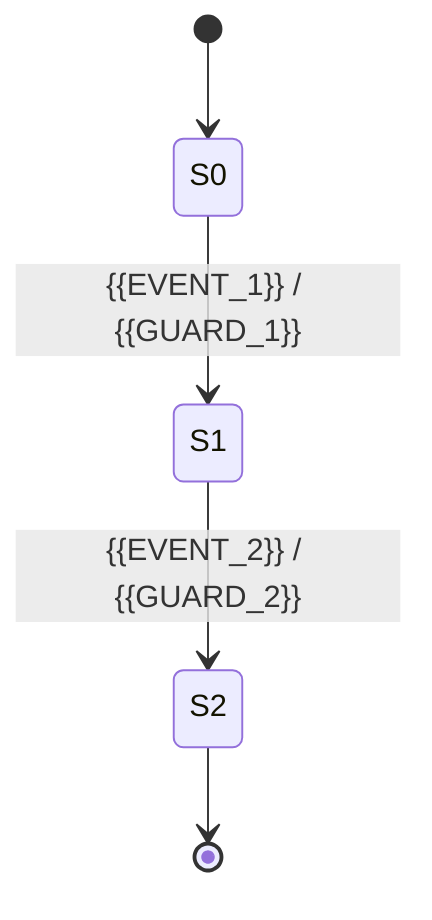

# State Transition Test Specification

## Target: {{STATEFUL_COMPONENT}}

## Test basis

| 項目 | 内容 |
| --- | --- |
| 対象 (test item) | {{STATEFUL_COMPONENT}} (セッション・注文・ジョブなど) |
| 根拠 (test basis) | {{SPEC_DOC}} |
| 判定基準 (test oracle) | 遷移後の状態と副作用 |
| プロファイル | {{PROFILE_NAME}} |

## Risk & tier

| risk_id | リスク | tier | 完了基準 |
| --- | --- | --- | --- |
| R-001 | {{RISK_DESCRIPTION}} | {{T1\|T2\|T3}} | 遷移 100% / カバレッジ {{COV}} |

## Design technique

| 技法 | 29119-4 節 | 適用箇所 |
| --- | --- | --- |
| State transition testing | 5.2.8 | 本ファイル全体 |
| Equivalence partitioning | 5.2.1 | 遷移の入力クラス |
| Error guessing | 5.4.1 | 不正遷移 |

## Document map

| 29119-3 情報項目 | 該当セクション |
| --- | --- |
| Test design specification | 状態モデル (test model) |
| Test case specification | 遷移テストケース |
| Test procedure specification | 実行順序 |
| Test execution log / result | `evidence/test-run-*.json` |

---

## 1. 状態 (States)

| state_id | 状態名 | 進入条件 | 退出条件 | 不変条件 |
| --- | --- | --- | --- | --- |
| S0 | {{INITIAL}} | 初期化 | {{EVENT_1}} | {{INVARIANT_0}} |
| S1 | {{ACTIVE}} | {{EVENT_1}} | {{EVENT_2}} | {{INVARIANT_1}} |
| S2 | {{TERMINAL}} | {{EVENT_2}} | なし | {{INVARIANT_2}} |

## 2. 遷移 (Transitions)

| trans_id | 源状態 | イベント | 遷移先 | ガード条件 | アクション | 期待結果 |
| --- | --- | --- | --- | --- | --- | --- |
| T1 | S0 | {{EVENT_1}} | S1 | {{GUARD_1}} | {{ACTION_1}} | {{RESULT_1}} |
| T2 | S1 | {{EVENT_2}} | S2 | {{GUARD_2}} | {{ACTION_2}} | {{RESULT_2}} |

## 3. 状態遷移図



## 4. テストケースへの写像 (TD3)

技法 5.2.8 は，「正常遷移」，「不正遷移」，「未定義遷移」の 3 種を要求する。

| case_id | 種別 | 源状態 | イベント | 期待状態 | 期待結果 |
| --- | --- | --- | --- | --- | --- |
| TC-S01 | 正常遷移 | S0 | {{EVENT_1}} | S1 | {{RESULT_1}} |
| TC-S02 | 不正遷移 | S0 | {{EVENT_2}} | S0 | {{ERROR_1}} |
| TC-S03 | 未定義遷移 | S1 | {{UNKNOWN_EVENT}} | S1 | {{ERROR_2}} |
| TC-S04 | ガード不成立 | S1 | {{EVENT_2}} | S1 | {{GUARD_REJECT}} |

### 遷移の網羅

| 確認項目 | 合格条件 |
| --- | --- |
| 定義済み遷移の実行 | 全 `trans_id` にケースがあること |
| 不正遷移 | 少なくとも 1 件が拒否されること |
| 未定義遷移 | 少なくとも 1 件が安全に拒否されること |
| 到達不能状態 | ないこと (あれば documented rationale) |

## 5. テスト関数

```typescript
describe('{{STATEFUL_COMPONENT}} 状態遷移', () => {
  test('S0 --{{EVENT_1}}--> S1', () => {
    const c = createComponent();
    c.dispatch('{{EVENT_1}}');
    expect(c.state).toBe('S1');
  });

  test('S0 --{{EVENT_2}}--> 拒否', () => {
    const c = createComponent();
    expect(() => c.dispatch('{{EVENT_2}}')).toThrow({{ERROR_1}});
    expect(c.state).toBe('S0');
  });
});
```

## 6. Traceability

| case_id | Req | ASVS | 800-53 | CC | Technique | Tier | Status |
| --- | --- | --- | --- | --- | --- | --- | --- |
| TC-S01 | REQ-{{ID}} | {{v5.0.0-V0.0.0}} | {{SP800-53r5.2/XX-X}} | {{ATE_FUN.1}} | 5.2.8 | T1 | ⬜ TODO |

ASVS / 800-53 / CC の各列は該当なしを `-` とする。空欄は禁止。
